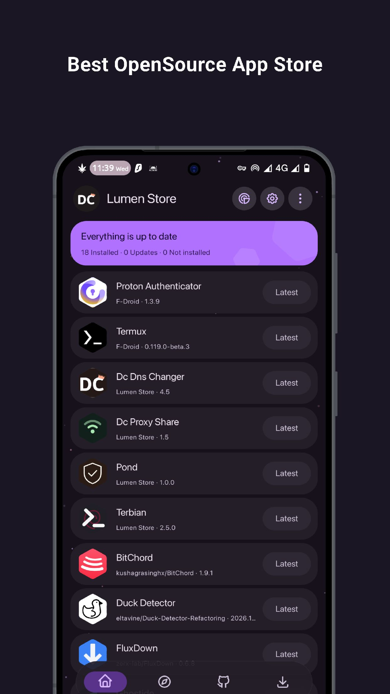
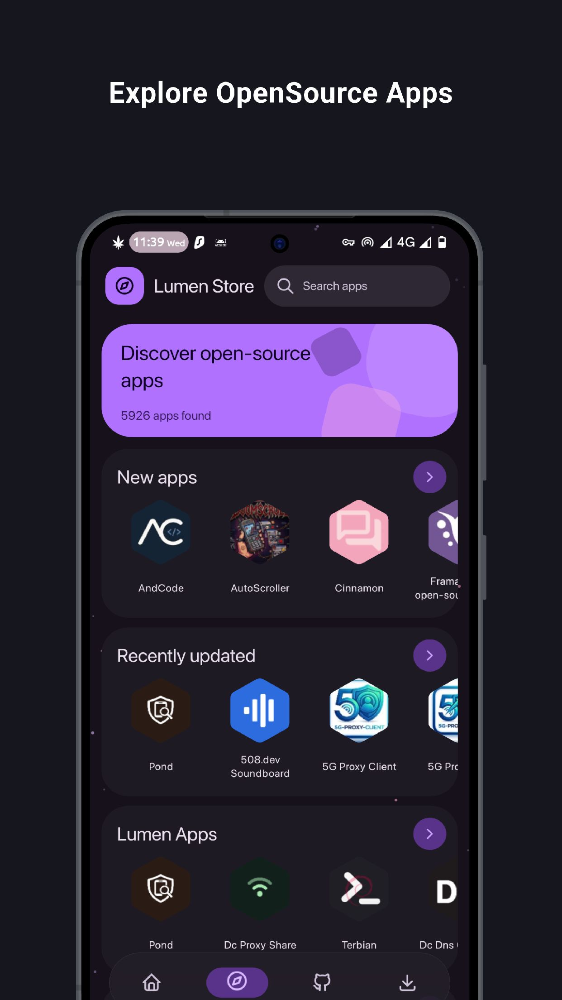
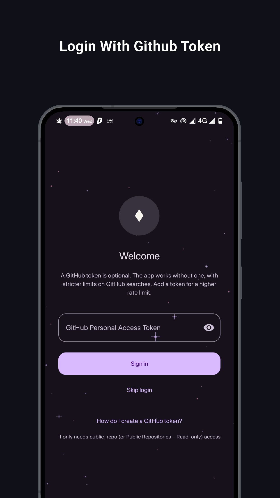
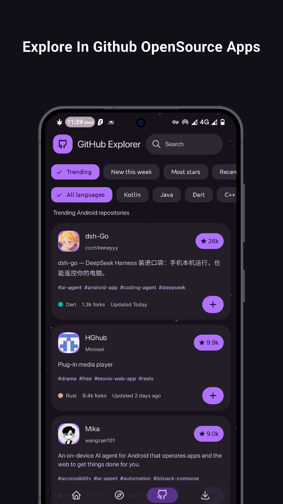
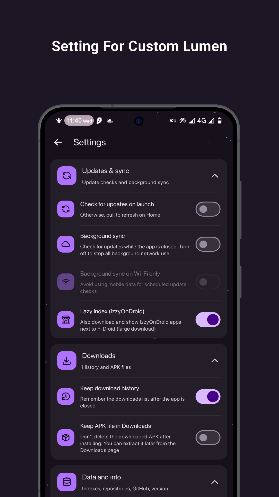

<div align="center" dir="rtl">


# لومن استور

**برنامه‌های اندرویدی متن‌باز را مستقیم از منبع پیدا، نصب و به‌روزرسانی کنید.**

[](https://github.com/deepcodecreate/lumenstore/actions/workflows/build.yml)
[](https://github.com/deepcodecreate/lumenstore/releases)
[](https://github.com/deepcodecreate/lumenstore/releases)
[](https://github.com/deepcodecreate/lumenstore/actions/workflows/codeql.yml)
[](LICENSE)
[](https://github.com/deepcodecreate/lumenstore/stargazers)

[English](README.md) · فارسی · [وب‌سایت](https://deepcodecreate.github.io/lumenstore/fa/)

</div>

---

<div dir="rtl">

## اسکرین‌شات‌ها

</div>

<div align="center">





</div>

<div dir="rtl">

## درباره برنامه

لومن استور برنامه‌های نصب‌شده روی گوشی شما را بررسی می‌کند، برنامه‌های متن‌باز را پیدا می‌کند و با دریافت مستقیم نسخه‌ها از F-Droid، IzzyOnDroid، GitHub، GitLab و Codeberg آن‌ها را به‌روز نگه می‌دارد. به حساب کاربری نیازی نیست و هیچ چیزی بدون اطلاع شما نصب نمی‌شود.

همچنین ابزاری برای کشف برنامه‌های تازه است: پروژه‌های GitHub را مرور کنید، README و تصاویرشان را ببینید، توسعه‌دهندگان را دنبال کنید و با یک ضربه نصب کنید.

## امکانات

### اسکن و به‌روزرسانی
- اسکن برنامه‌های نصب‌شده و تطبیق آن‌ها با ایندکس‌های F-Droid و IzzyOnDroid و نسخه‌های GitHub
- نمایش برنامه‌های دارای به‌روزرسانی و نصب با یک ضربه
- انتخاب خودکار APK مناسب معماری دستگاه
- اسکن در پس‌زمینه و اعلان برای به‌روزرسانی‌های جدید
- اسکن کامل و دریافت دوباره ایندکس‌ها

### کاوش
- مرور و جست‌وجوی مخازن GitHub
- نمایش کامل README همراه با جدول، نشان‌ها، تصاویر SVG و اسکرین‌شات‌ها
- پروفایل مینیمال و جمع‌وجور کاربران و سازمان‌های GitHub همراه با مخازن، فعالیت‌ها و آمار
- جست‌وجو در Google Play و رسیدن به نسخه‌های متن‌باز مشابه
- هشدار ویژگی‌های نامطلوب (Anti-Features) برای برنامه‌های ایندکس F-Droid

### منابع
- مخازن F-Droid و IzzyOnDroid به‌صورت پیش‌فرض
- افزودن مخزن دلخواه از GitHub، GitLab یا Codeberg
- توکن اختیاری GitHub برای محدودیت درخواست بالاتر، بدون نیاز به ورود برای استفاده از برنامه
- پشتیبانی از DNS over HTTPS برای اتصال پایدارتر

### شخصی‌سازی
- طراحی Material 3 با رنگ‌های پویا و چند تم
- حالت روشن و تاریک
- شکل‌های دلخواه برای آیکون برنامه‌ها
- پس‌زمینه‌های زنده: شفق، حباب، ستاره، موج و کرم شب‌تاب
- زبان انگلیسی و فارسی با پشتیبانی کامل از راست‌به‌چپ

### پشتیبان‌گیری و اشتراک‌گذاری
- پشتیبان‌گیری و بازیابی فهرست برنامه‌ها، همراه با پشتیبان‌گیری خودکار اختیاری
- اشتراک‌گذاری برنامه‌ها با لینک `lumenstore://app/<package-name>`
- باز شدن مستقیم لینک‌های Google Play، F-Droid و GitHub در برنامه

## دانلود

آخرین APK را از صفحه [Releases](https://github.com/deepcodecreate/lumenstore/releases) دریافت کنید.

نیازمند اندروید ۸٫۰ (API 26) یا بالاتر. در اولین به‌روزرسانی باید اجازه نصب از طرف برنامه را بدهید.

## ساخت از روی سورس

پیش‌نیازها: JDK 17 و Android SDK (پلتفرم 36).

</div>

```bash
git clone https://github.com/deepcodecreate/lumenstore.git
cd lumenstore
./gradlew assembleDebug
```

<div dir="rtl">

فایل APK در مسیر `app/build/outputs/apk/debug/` ساخته می‌شود.

### ساخت نسخه امضاشده

فایل `keystore.properties` را در ریشه پروژه بسازید:

</div>

```properties
storeFile=../keystore/release.keystore
storePassword=YOUR_STORE_PASSWORD
keyAlias=YOUR_KEY_ALIAS
keyPassword=YOUR_KEY_PASSWORD
```

<div dir="rtl">

سپس اجرا کنید:

</div>

```bash
./gradlew assembleRelease
```

<div dir="rtl">

اگر `keystore.properties` وجود نداشته باشد، نسخه release با کلید debug امضا می‌شود.

## گیتهاب اکشن

| ورک‌فلو | محرک | کار |
|---------|------|-----|
| [Build](.github/workflows/build.yml) | پوش به `main`، پول‌ریکوئست، دستی | ساخت APK دیباگ و آپلود به‌عنوان آرتیفکت |
| [Release](.github/workflows/release.yml) | تگ‌های `v*`، دستی | ساخت APK ریلیز و انتشار در GitHub Releases |

برای امضای نسخه‌های ریلیز در CI این Secretها را به مخزن اضافه کنید:

| Secret | مقدار |
|--------|-------|
| `KEYSTORE_BASE64` | کی‌استور شما با خروجی `base64 -w0 release.keystore` |
| `KEYSTORE_PASSWORD` | رمز کی‌استور |
| `KEY_ALIAS` | نام کلید |
| `KEY_PASSWORD` | رمز کلید |

برای انتشار یک نسخه:

</div>

```bash
git tag v0.5.10-beta
git push origin v0.5.10-beta
```

<div dir="rtl">

## فناوری‌ها

- Java، AndroidX و Material Components 1.14
- Retrofit، OkHttp و Gson برای شبکه
- Glide و AndroidSVG برای تصاویر
- Markwon برای نمایش Markdown و HTML
- WorkManager برای اسکن و پشتیبان‌گیری پس‌زمینه
- Tabler Icons

## حریم خصوصی و امنیت

- بدون تحلیل‌گر، تبلیغات، ردیاب و گزارش خطا
- بدون نیاز به حساب کاربری؛ توکن اختیاری گیتهاب فقط روی دستگاه شما می‌ماند
- هر نسخه همراه با چک‌سام SHA-256 و گواهی امضاشده منشأ ساخت منتشر می‌شود

سیاست کامل را در [حریم خصوصی](PRIVACY.md) و [سیاست امنیتی](SECURITY.md) بخوانید. آسیب‌پذیری‌ها را از تب Security به‌صورت خصوصی گزارش دهید.

## جامعه

- سؤال و ایده‌ها را در [Discussions](https://github.com/deepcodecreate/lumenstore/discussions) مطرح کنید
- باگ‌ها را در [Issues](https://github.com/deepcodecreate/lumenstore/issues/new/choose) گزارش دهید
- برای ترجمه برنامه به [CONTRIBUTING](CONTRIBUTING.md) سر بزنید
- [تاریخچه تغییرات](CHANGELOG.md)

اگر لومن استور برایتان مفید بود، یک ستاره به پیدا شدن آن توسط دیگران کمک می‌کند.

## مشارکت

ایشو و پول‌ریکوئست خوش‌آمد است. برای تغییرات بزرگ لطفاً اول یک ایشو باز کنید.

1. مخزن را Fork کنید
2. یک شاخه بسازید: `git checkout -b feature/my-change`
3. تغییرات را کامیت و شاخه را پوش کنید
4. پول‌ریکوئست باز کنید

## مجوز

لومن استور تحت مجوز [GNU General Public License v3.0](LICENSE) منتشر شده است.

</div>

<div align="center">

ساخته‌شده توسط [deepcodecreate](https://github.com/deepcodecreate)

</div>
