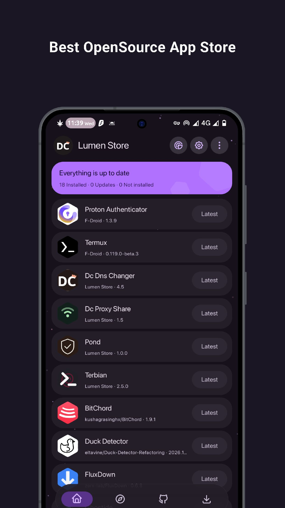
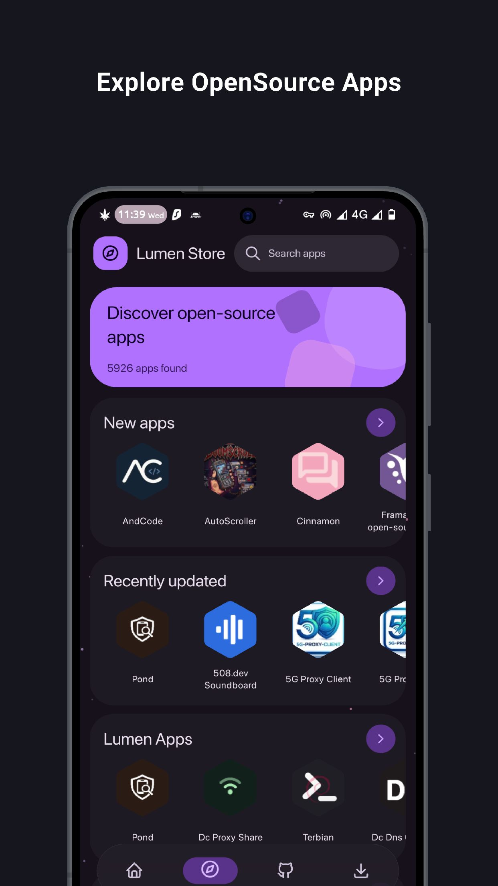
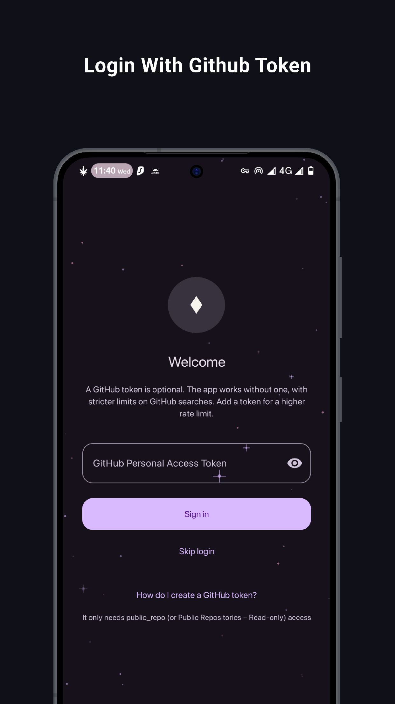
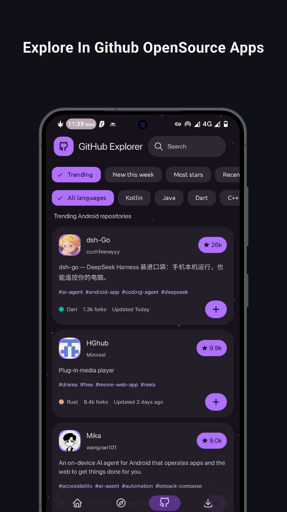
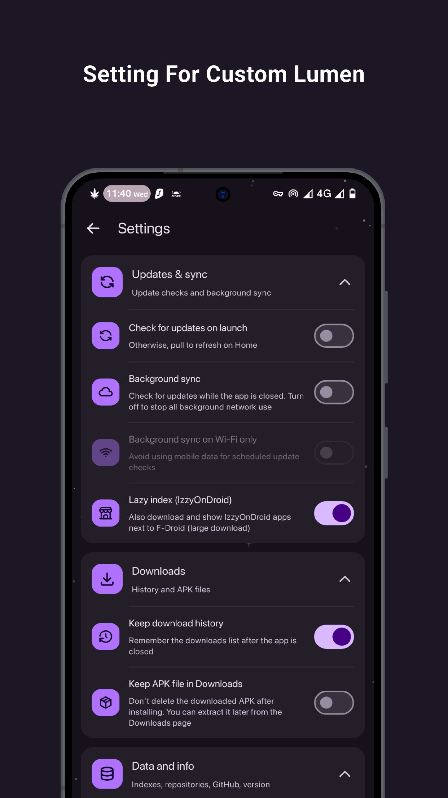

<div align="center">


# Lumen Store

**Find, install and update open-source Android apps straight from their source.**

[](https://github.com/deepcodecreate/lumenstore/actions/workflows/build.yml)
[](https://github.com/deepcodecreate/lumenstore/releases)
[](https://github.com/deepcodecreate/lumenstore/releases)
[](https://github.com/deepcodecreate/lumenstore/actions/workflows/codeql.yml)
[](LICENSE)
[](https://github.com/deepcodecreate/lumenstore/stargazers)


English · [فارسی](README.fa.md) · [Website](https://deepcodecreate.github.io/lumenstore/)

</div>

---

## Screenshots

<div align="center">





</div>

## About

Lumen Store looks at the apps already installed on your phone, finds the ones that are open source, and keeps them up to date by downloading releases directly from F-Droid, IzzyOnDroid, GitHub, GitLab and Codeberg. No account is required, and nothing is installed behind your back.

It also works as a discovery tool: browse GitHub projects, read their READMEs and screenshots, follow developers, and install what you like in one tap.

## Features

### Scan and update
- Scans your installed apps and matches them against the F-Droid and IzzyOnDroid indexes and GitHub releases
- Shows which apps have updates and installs them in one tap
- Picks the right APK for your device ABI
- Background scanning with notifications for new updates
- Full rescan and index redownload when you need a clean slate

### Explore
- Browse and search GitHub repositories
- Rich README rendering with tables, badges, SVG images and screenshots
- Compact, minimal GitHub user and organization profiles with repositories, activity and stats
- Search Google Play listings and jump to their open-source counterparts
- Anti-feature warnings for apps from F-Droid indexes

### Sources
- Built-in F-Droid and IzzyOnDroid repositories
- Add your own repositories from GitHub, GitLab or Codeberg
- Optional GitHub token for a higher API rate limit, with no sign-in required to use the app
- DNS over HTTPS support for more reliable connections

### Personalisation
- Material 3 design with dynamic seed colors and multiple themes
- Light and dark modes
- Custom app icon shapes
- Animated live backgrounds: aurora, bubbles, stars, ripples and fireflies
- English and Persian (فارسی) with full RTL support

### Backup and sharing
- Backup and restore your app list, with optional automatic backups
- Share apps with `lumenstore://app/<package-name>` deep links
- Opens Google Play, F-Droid and GitHub links directly in the app

## Download

Grab the latest APK from the [Releases](https://github.com/deepcodecreate/lumenstore/releases) page.

[](https://deepcodecreate.github.io/lumenstore/app.html?id=com.opensourcefinder.app)

Requires Android 8.0 (API 26) or newer. You will need to allow installs from this app the first time you update something.

## Build from source

Requirements: JDK 17 and the Android SDK (platform 36).

```bash
git clone https://github.com/deepcodecreate/lumenstore.git
cd lumenstore
./gradlew assembleDebug
```

The APK is written to `app/build/outputs/apk/debug/`.

### Signed release build

Create `keystore.properties` in the project root:

```properties
storeFile=../keystore/release.keystore
storePassword=YOUR_STORE_PASSWORD
keyAlias=YOUR_KEY_ALIAS
keyPassword=YOUR_KEY_PASSWORD
```

Then run:

```bash
./gradlew assembleRelease
```

Without `keystore.properties`, release builds fall back to the debug signing key.

## GitHub Actions

| Workflow | Trigger | What it does |
|----------|---------|--------------|
| [Build](.github/workflows/build.yml) | Push to `main`, pull requests, manual | Builds a debug APK and uploads it as an artifact |
| [Release](.github/workflows/release.yml) | Tags matching `v*`, manual | Builds a release APK and publishes it to GitHub Releases |

To sign release builds in CI, add these repository secrets:

| Secret | Value |
|--------|-------|
| `KEYSTORE_BASE64` | Your keystore encoded with `base64 -w0 release.keystore` |
| `KEYSTORE_PASSWORD` | Keystore password |
| `KEY_ALIAS` | Key alias |
| `KEY_PASSWORD` | Key password |

To publish a release:

```bash
git tag v0.6.1-beta
git push origin v0.6.1-beta
```

## Tech stack

- Java, AndroidX, Material Components 1.14
- Retrofit, OkHttp and Gson for networking
- Glide and AndroidSVG for images
- Markwon for Markdown and HTML rendering
- WorkManager for background scans and backups
- Tabler Icons

## Privacy and security

- No analytics, ads, trackers or crash reporting
- No account required; a GitHub token is optional and stays on your device
- Every release is published with SHA-256 checksums and a signed build provenance attestation

Verify a download:

```bash
sha256sum -c SHA256SUMS.txt
gh attestation verify Lumenstore-vX.Y.Z.apk --repo deepcodecreate/lumenstore
```

Read the full [Privacy Policy](PRIVACY.md) and [Security Policy](SECURITY.md). Report vulnerabilities privately through the Security tab.

## Community

- Ask questions and share ideas in [Discussions](https://github.com/deepcodecreate/lumenstore/discussions)
- Report bugs in [Issues](https://github.com/deepcodecreate/lumenstore/issues/new/choose)
- Help translate the app, see [CONTRIBUTING](CONTRIBUTING.md)
- Read the [Changelog](CHANGELOG.md)

If Lumen Store is useful to you, a star helps other people find it.

[](https://star-history.com/#deepcodecreate/lumenstore&Date)

## Contributing

Issues, translations and pull requests are welcome. Please read [CONTRIBUTING](CONTRIBUTING.md) and the [Code of Conduct](CODE_OF_CONDUCT.md). For larger changes, open an issue first so we can talk it through.

1. Fork the repository
2. Create a branch: `git checkout -b feature/my-change`
3. Commit your changes and push the branch
4. Open a pull request

## License

Lumen Store is released under the [GNU General Public License v3.0](LICENSE).

<div align="center">

Made by [deepcodecreate](https://github.com/deepcodecreate)

</div>
